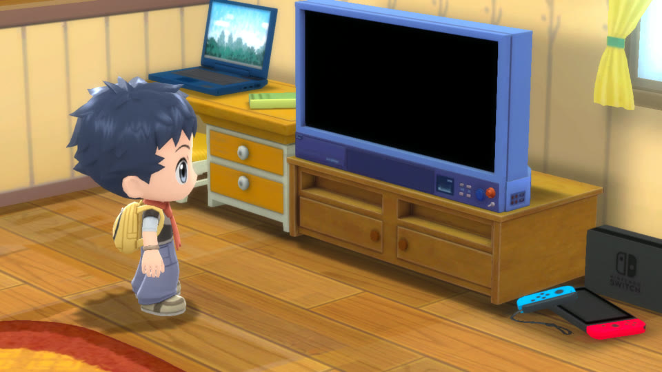
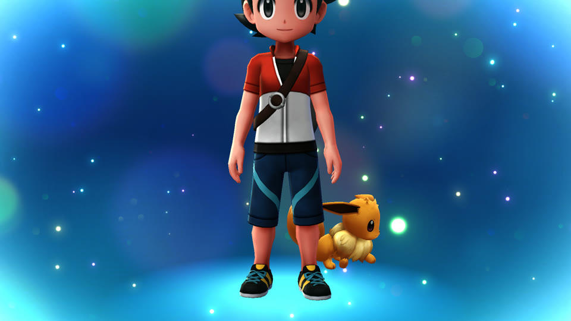
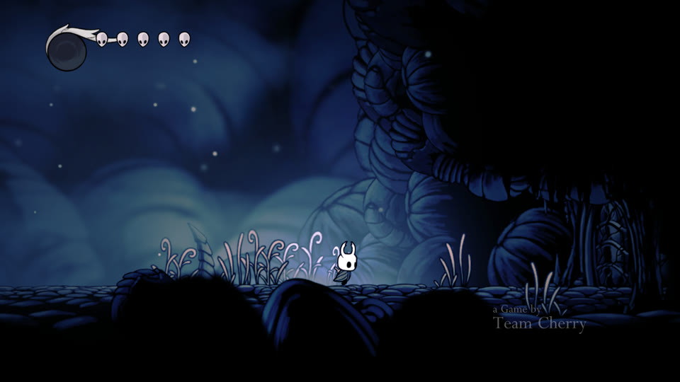
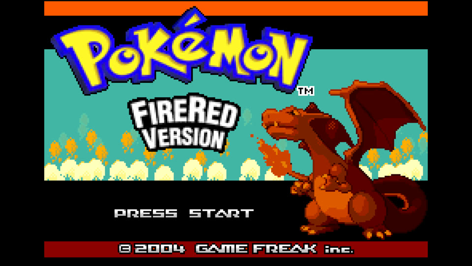
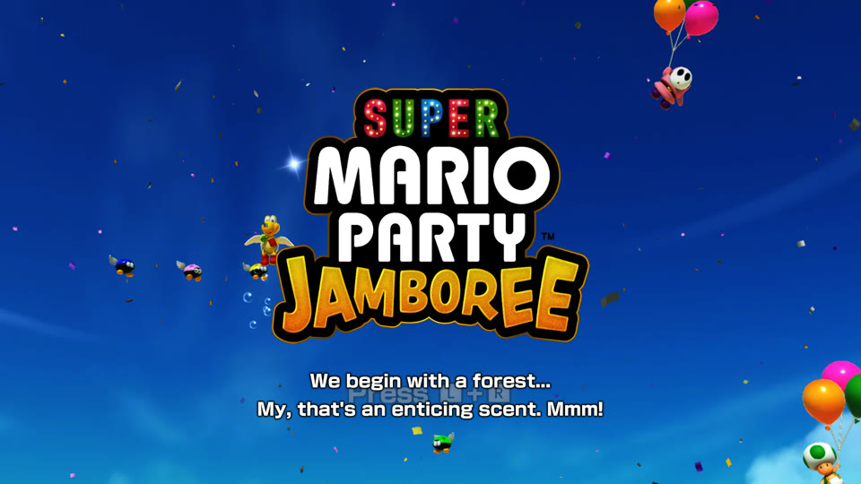

# nxasahi

Play your own Nintendo Switch games natively on Apple silicon Macs running [Asahi Linux](https://asahilinux.org). You bring the game (its NSP, XCI or NSZ files) and your `prod.keys`. Drop them on the game library window, and it builds the game once and adds it as a tile you double-click to play.

nxasahi is not an emulator: the game's own code runs directly on the M-series CPU, and Switch graphics are rebuilt on Vulkan through Asahi's Honeykrisp driver. It is a port of [nxnative](https://github.com/seedds/nxnative), which does the same on iPhone, iPad and macOS with Metal. Nothing from any game is in this repository, and the project is not affiliated with Nintendo, any game publisher or the Asahi Linux project.

## Status

This is an early port. **Ten games have been played on Linux so far**, each as far as the rating says:

| Rating | Meaning |
|---|---|
| 🏆 **Perfect** | Played through with no known issues |
| 🥇 **Gold** | Plays well; nothing wrong seen in play so far |
| 🥈 **Silver** | Playable, with a known limit (frame rate, or only played a short way) |
| 🥉 **Bronze** | Boots and gets into the game, but not played far yet |

<table>
<tr>
<td align="center" valign="top" width="33%"><br><a href="dm/games/010015100B514000/README.md">Super Mario Bros. Wonder</a><br><b>🥇 Gold</b><br><sub>Title, world map and levels at 60 fps, with sound</sub></td>
<td align="center" valign="top" width="33%"><br><a href="dm/games/01006A800016E000/README.md">Super Smash Bros. Ultimate</a><br><b>🥇 Gold</b><br><sub>Plays well</sub></td>
<td align="center" valign="top" width="33%"><br><a href="dm/games/0100A5C00D162000/README.md">Cuphead</a><br><b>🥇 Gold</b><br><sub>Plays well</sub></td>
</tr>
<tr>
<td align="center" valign="top" width="33%"><br><a href="dm/games/01004AB00A260000/README.md">DARK SOULS: REMASTERED</a><br><b>🥈 Silver</b><br><sub>Opening movie, character creation and the Undead Asylum · 30 fps on the base game (60 with update 1.0.3)</sub></td>
<td align="center" valign="top" width="33%"><br>Pokémon Shining Pearl<br><b>🥈 Silver</b><br><sub>Intro and the opening scenes · capped at 30 fps</sub></td>
<td align="center" valign="top" width="33%"><br>Pokémon: Let's Go, Eevee!<br><b>🥈 Silver</b><br><sub>Intro, Oak's speech and the 3D bedroom</sub></td>
</tr>
<tr>
<td align="center" valign="top" width="33%"><br><a href="dm/games/0100633007D48000/README.md">Hollow Knight</a><br><b>🥈 Silver</b><br><sub>Title, intro movies and King's Pass at 60 fps</sub></td>
<td align="center" valign="top" width="33%"><br><a href="dm/games/0100CD801CE5E000/README.md">Balatro</a><br><b>🥈 Silver</b><br><sub>Intro, title and a run's tutorial at about 59 fps, with sound · OpenGL</sub></td>
<td align="center" valign="top" width="33%"><br>Pokémon FireRed Version<br><b>🥉 Bronze</b><br><sub>Builds and renders; not played far</sub></td>
</tr>
<tr>
<td align="center" valign="top" width="33%"><br><a href="dm/games/0100965017338000/README.md">Super Mario Party Jamboree</a><br><b>🥉 Bronze</b><br><sub>Boots to its title screen at 60 fps</sub></td>
</tr>
</table>

Screenshots are from Linux, except Wonder, Smash, Cuphead, Dark Souls and Balatro, which are nxnative's from the Mac.

What works so far:

- **Graphics:** NVN games are drawn on Vulkan, OpenGL games on the system's OpenGL (Mesa). Games that use Vulkan on the Switch are not supported on Linux yet.
- **Shaders:** only from games whose shaders are all in their files. The import stops on games whose shaders have to be captured or decoded by booting them (run-time compiles, Unreal Engine or Oodle packs), because nxnative does that step in its Mac host.
- **Input and sound:** keyboard and SDL gamepads work, and sound plays through SDL3 (PipeWire, PulseAudio or ALSA).

nxnative's [games table](dm/games/README.md#games) lists the 70-odd games that run on the iPhone or the Mac. Their profiles are in this repository too, and the NSP games among them are the next candidates for Linux. Status, milestones and open issues of the port are in [LINUX.md](LINUX.md).

## Install

You need Asahi Linux (or another Linux on Apple silicon with the Asahi Mesa drivers) and [Nix](https://nixos.org/download) with flakes enabled. nxasahi is one Nix package: the game library, the import tools and everything they run.

```sh
nix profile install github:Sheepheerd/nxasahi/linux-headless   # installs the nxasahi command and its app launcher entry
nix run github:Sheepheerd/nxasahi/linux-headless               # or try it without installing
```

On NixOS you can add it to your system flake instead: take `github:Sheepheerd/nxasahi/linux-headless` as an input and put `inputs.nxasahi.packages.aarch64-linux.default` in `environment.systemPackages`.

The first import of a game compiles that game's host. The package brings the compiler with it; what it builds goes to `~/.local/share/nxasahi/build` (`NXASAHI_STATE` moves it).

Put your keys in `~/.switch/prod.keys`, or choose another path in the library's Preferences.

**From source** (to work on nxasahi): clone the repository and run the library from it, in the dev shell, which has the same tools and the .NET SDK:

```sh
git clone https://github.com/Sheepheerd/nxasahi.git && cd nxasahi
frontend/nxasahi.sh  # enters nix develop and starts the library; `nix build` builds the package
```

If you use [direnv](https://direnv.net), `direnv allow` loads the shell whenever you enter the folder.

## Play: the game library

Start **nxasahi** from your app launcher, or run `nxasahi`. It opens a console-style home screen: your games in a row, newest played first, with the chosen game's name and state underneath. A controller drives it as on a Switch, and so do the keyboard and the mouse (F11 switches fullscreen):

| Button | Keyboard | Home screen | Pages |
|---|---|---|---|
| D-pad / left stick | Arrow keys | Choose a game | Move between rows (↕), change a value (↔) |
| A | Return | Play the game (on the **+** tile: add games) | Select |
| B | Escape | — | Back |
| X | X | The game's options | — |
| Y | Y | Rebuild the game | — |
| + | + (Ctrl+O) | Add games | — |
| − | − (Ctrl+,) | Settings | — |

- **Add a game:** drag its NSP, XCI, NSZ or XCZ files onto the window, or press **+**. A base game is extracted, rewritten and its shaders translated, with progress on its tile and in a card at the bottom right (**Output** shows the import's log, **Stop** stops it). The first import takes a few minutes, and a later rebuild reuses every step whose inputs did not change. Drop an update or DLC to add it to its game, or pick it with **Add update or DLC…** in the game's options; the game is then rebuilt with it. The newest version you have is used, and any version works (each game was tested on the version its note names).
- **A game's options** (X, or right-click its tile): play or stop, its language and extra environment variables, **Add update or DLC…**, **Rebuild**, **Build shader cache** (compiles every shader the game has not compiled yet for your GPU, so nothing stutters in play), its save, log and game folders, and **Remove from library**.
- **Settings** (−, or the ⚙ button): the keys file, game language, fullscreen, sound, fast cores only (on by default, which keeps the game on the performance cores), **Build the full shader cache** (on by default: an import or rebuild ends by compiling every shader for your GPU, a few minutes for a big game; off leaves them to be compiled while you play, with stutter until they are done), how many threads compile, on the efficiency cores while you play, any shaders not compiled yet, starting the library in fullscreen, and **Add to the app launcher** (the installed package already has an entry).
- **Controllers** (the 🎮 button, Ctrl+K): each of the eight players' keyboard and controller, the stick deadzone and every binding. Choose a binding, press A, then press the key or controller input to give it; Backspace unbinds.

Where things go:

| What | Where |
|---|---|
| Games (links to your files, plus the extracted files, shaders and host: several GB each) | `~/.local/share/nxasahi/games/<title ID>/` |
| Saves (kept when a game is rebuilt or removed) | `~/.local/share/nxasahi/saves/<title ID>/` |
| Settings | `~/.config/nxasahi/` |
| Compiled shaders | `~/.cache/nxasahi/vkshaders/` |

**Shaders.** On a game's first run, two low-priority threads compile all of its shaders in the background and keep them on disk. For Mario Wonder, that takes about a minute and 144 MB. After that, no shader is compiled during play.

### Controls

A connected controller is used as player 1 (more controllers become players 2, 3, …). Buttons go by position, as on a Switch controller.

| Switch | Keyboard |
|---|---|
| Left stick | W A S D |
| A B X Y | J K U I |
| L R ZL ZR | Q E Z C |
| + / − | Return / Tab |
| D-pad | Arrow keys |
| Press left / right stick | F / G |
| Shake | Space |

## From a terminal

The library runs the same import as the packing script. To build one game's folder of NSPs by hand (inside `nix develop`):

```sh
python3 scripts/build_ipa_from_nsp.py ~/Games/MarioWonder -k ~/.switch/prod.keys --platform linux
```

It writes `<title ID>_build/linux_game.json` beside the NSPs and ends by printing the command that runs the game in a window. You need free disk space of about twice the NSPs' size plus 10 GB. Pick the game language with `-l` (`-l ja`, `-l French`), and see `-h` for the other options. NSZ and XCZ files are decompressed once into `<title ID>_build/nsp/`, which takes their full size on disk.

Building the host by hand, running a game headless, and the environment variables used for debugging are in [LINUX.md](LINUX.md).

## Known issues

- No amiibo and no online features.
- Memory: Honeykrisp keeps a game's whole GPU-visible heap resident from the start. Mario Wonder uses about 1.95 GB of RAM where the Mac uses 0.5 GB.
- Short hitches (up to about 60 ms) when many new textures load at once.
- The shared fonts are replaced with DejaVu Sans, so Chinese, Japanese and Korean text is not shown yet.
- More in [LINUX.md](LINUX.md#known-gaps-open).

## Acknowledgements

This project is built on other people's work:

- **[nxnative](https://github.com/seedds/nxnative)** (MIT): nxasahi is a port of it, and almost everything is nxnative's own work: the NSO rewriter, the host that stands in for Horizon, the NVN layer, the shader translation chain and every game profile. Linux-only code lives in `dm/host/linux/`, `dm/host/Makefile.linux`, `frontend/` and `flake.nix`, so that upstream changes merge cleanly.
- **[d2r-mobile](https://github.com/jhaizhou-ops/d2r-mobile)** (MIT) developed this native-execution approach, for Diablo II: Resurrected, and nxnative started from its generic parts.
- **[Asahi Linux](https://asahilinux.org)**: the kernel and the Honeykrisp Vulkan driver (Mesa) this runs on.
- **Ryujinx** (MIT): its shader translator (`Ryujinx.Graphics.Shader`, `Ryujinx.Common` and `Spv.Generator` 1.3.2, in `dm/third_party/ryujinx` with a few fixes listed in [its README](dm/third_party/ryujinx/README.md)) turns the games' Maxwell shaders into SPIR-V. Its emulation of the kernel and system services is also a reference when the host's behaviour is in doubt.
- **[Atmosphère](https://github.com/Atmosphere-NX/Atmosphere)**: its kernel, mesosphère, is the reference for Horizon's synchronization semantics (address arbiter, condition variables).
- **yuzu**: Maxwell instruction encodings for the shader reference tool, and a cross-check for kernel behaviour.
- **[LibHac](https://github.com/Thealexbarney/LibHac)**: reads NSPs and layers updates over the base game in `dm/tools/nx_extract`. **hactool** did the first extractions.
- **[SDL3](https://libsdl.org)**: the window, input and sound on Linux. **Qt 6** (through **PySide6**): the game library.
- **[SPIRV-Cross](https://github.com/KhronosGroup/SPIRV-Cross)** and **[glslang](https://github.com/KhronosGroup/glslang)**: used by the shader chain shared with nxnative.
- **deko3d** (zlib): its texture layout size algorithm is ported in `dm/gfx/nvn/nvn_tex.c`.
- **libvpx** (VP9 movies), **stb_vorbis** (movie sound), the **Vulkan headers** and **NVIDIA FLIP** ship in `dm/third_party` with their licenses ([list](dm/third_party/README.md)).
- **Capstone**, **lz4**, **fontTools**, **nsz** and the **DejaVu** fonts are used by the build.

## For developers

The port's design, status and debugging switches are in [LINUX.md](LINUX.md). nxnative's internals, per-game notes and bring-up guides apply here too: [docs/development.md](docs/development.md), [dm/games](dm/games/README.md#games) and [docs/agents](docs/agents/README.md).

## License

MIT (see [LICENSE](LICENSE)). Third-party code keeps its own license; see [dm/third_party](dm/third_party/README.md).
