# Top 20 Switch games

The twenty best-selling Nintendo Switch games, by Nintendo's worldwide sales as of June 30, 2026 ([Nintendo IR](https://www.nintendo.co.jp/ir/en/finance/software/switch.html), [Wikipedia](https://en.wikipedia.org/wiki/List_of_best-selling_Nintendo_Switch_video_games)), and how far each has been played on Linux. Ratings are the ones in the [README](../README.md#status). Cover art is from each game's Wikipedia article.

<table>
<tr>
<td align="center" valign="top" width="25%">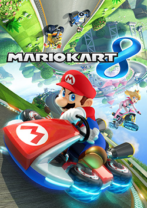 <b>1.</b> Mario Kart 8 Deluxe <i>Hasn't been tested</i></td>
<td align="center" valign="top" width="25%">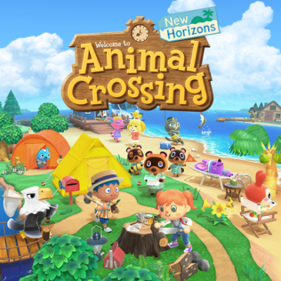 <b>2.</b> Animal Crossing: New Horizons <i>Hasn't been tested</i></td>
<td align="center" valign="top" width="25%">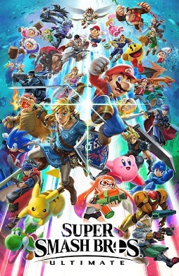 <b>3.</b> <a href="../dm/games/01006A800016E000/README.md">Super Smash Bros. Ultimate</a> 🥇 Gold Plays well</td>
<td align="center" valign="top" width="25%">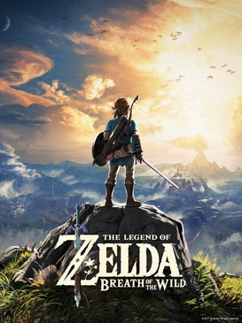 <b>4.</b> The Legend of Zelda: Breath of the Wild <i>Hasn't been tested</i></td>
</tr>
<tr>
<td align="center" valign="top" width="25%">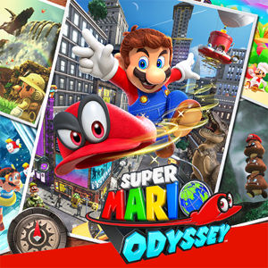 <b>5.</b> Super Mario Odyssey <i>Hasn't been tested</i></td>
<td align="center" valign="top" width="25%">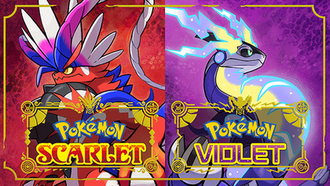 <b>6.</b> Pokémon Scarlet / Violet <i>Hasn't been tested</i></td>
<td align="center" valign="top" width="25%">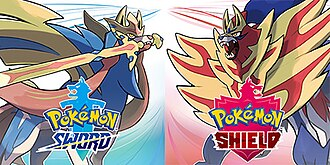 <b>7.</b> Pokémon Sword / Shield <i>Hasn't been tested</i></td>
<td align="center" valign="top" width="25%">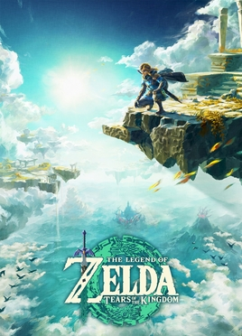 <b>8.</b> The Legend of Zelda: Tears of the Kingdom <i>Hasn't been tested</i></td>
</tr>
<tr>
<td align="center" valign="top" width="25%">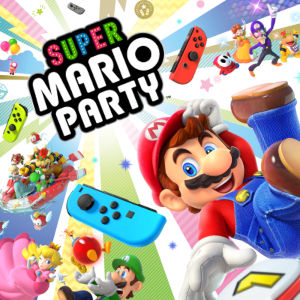 <b>9.</b> Super Mario Party <i>Hasn't been tested</i></td>
<td align="center" valign="top" width="25%">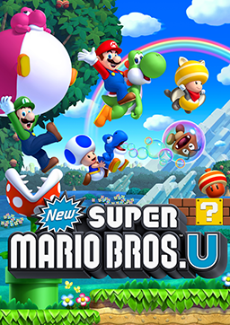 <b>10.</b> New Super Mario Bros. U Deluxe <i>Hasn't been tested</i></td>
<td align="center" valign="top" width="25%">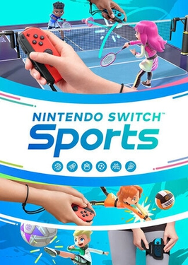 <b>11.</b> Nintendo Switch Sports <i>Hasn't been tested</i></td>
<td align="center" valign="top" width="25%">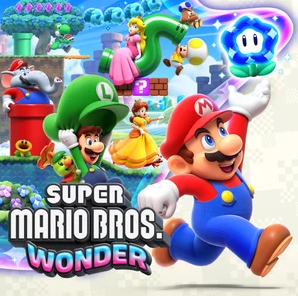 <b>12.</b> <a href="../dm/games/010015100B514000/README.md">Super Mario Bros. Wonder</a> 🥇 Gold Title, world map and levels at 60 fps, with sound</td>
</tr>
<tr>
<td align="center" valign="top" width="25%">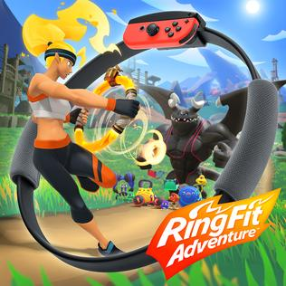 <b>13.</b> Ring Fit Adventure <i>Hasn't been tested</i></td>
<td align="center" valign="top" width="25%">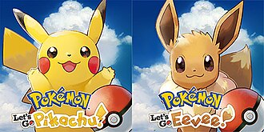 <b>14.</b> Pokémon: Let's Go, Pikachu! / Eevee! 🥈 Silver Let's Go, Eevee!: intro, Oak's speech and the 3D bedroom</td>
<td align="center" valign="top" width="25%">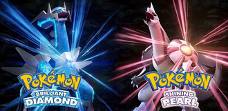 <b>15.</b> Pokémon Brilliant Diamond / Shining Pearl 🥈 Silver Shining Pearl: intro and the opening scenes · capped at 30 fps</td>
<td align="center" valign="top" width="25%">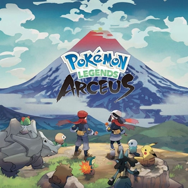 <b>16.</b> Pokémon Legends: Arceus <i>Hasn't been tested</i></td>
</tr>
<tr>
<td align="center" valign="top" width="25%">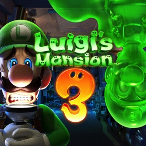 <b>17.</b> Luigi's Mansion 3 <i>Hasn't been tested</i></td>
<td align="center" valign="top" width="25%">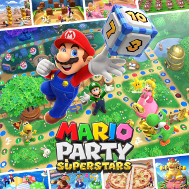 <b>18.</b> Mario Party Superstars <i>Hasn't been tested</i></td>
<td align="center" valign="top" width="25%">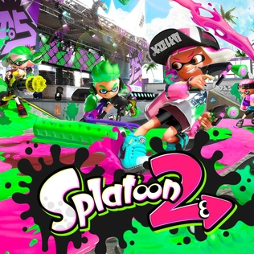 <b>19.</b> Splatoon 2 <i>Hasn't been tested</i></td>
<td align="center" valign="top" width="25%">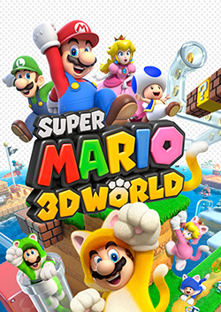 <b>20.</b> Super Mario 3D World + Bowser's Fury <i>Hasn't been tested</i></td>
</tr>
</table>
